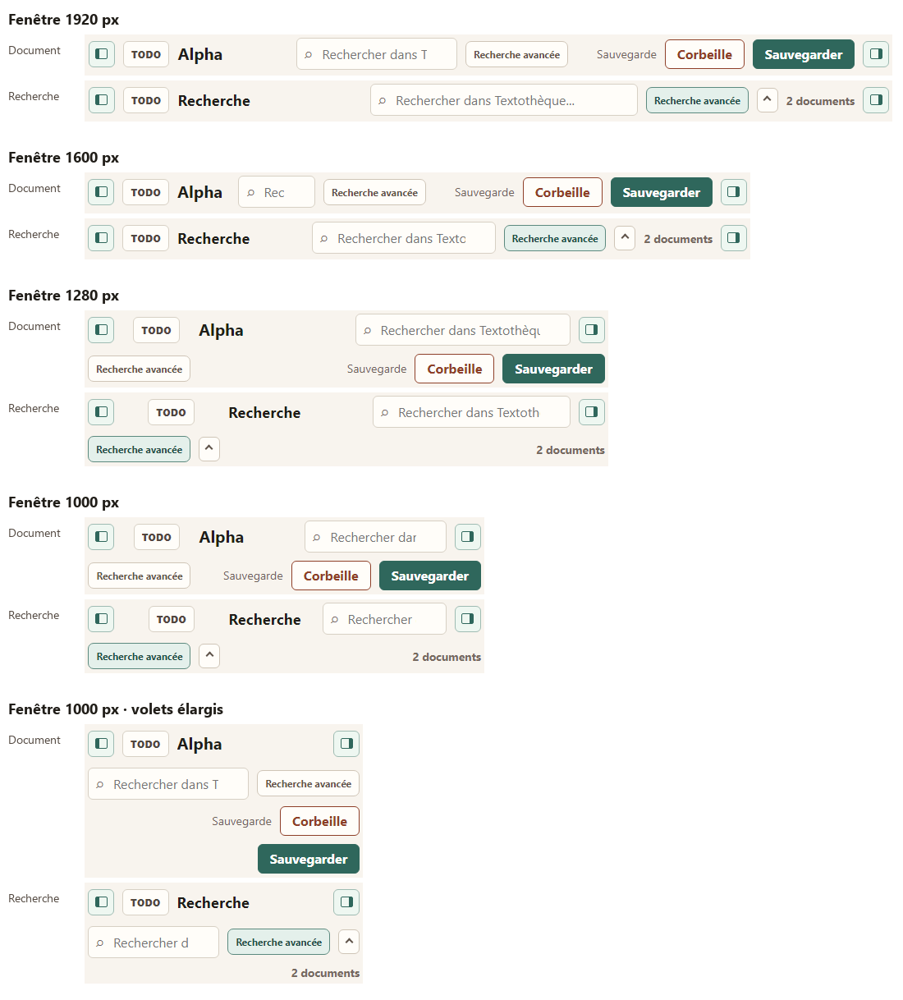

# Mission 045 — Cohérence structurelle des barres d’outils

**Verdict technique GO. Recette esthétique à valider par David.** À chacune des dimensions comparées, le bouton Métadonnées occupe la même position en édition et en recherche. Le bouton de navigation reste à gauche. Les deux vues passent ensemble à une disposition plus compacte lorsque la largeur du panneau central le demande.

## Diagnostic avant modification

Les deux en-têtes JSX portaient déjà la classe `editor-toolbar` et présentaient sept enfants dans le même ordre. En édition, les deux premiers commandent la navigation et le TODO. Le titre et le champ se partagent la largeur flexible. Viennent ensuite la recherche avancée, les commandes documentaires et, en dernière colonne, le bouton Métadonnées. Sa position indique le volet qu’il commande.

En recherche, la surcharge `.catalog-header.search-header` remplaçait cette grille par un flux flex aligné à gauche. Le compteur et le bouton Métadonnées suivaient les éléments précédents. Le plafond de 18 rem du champ et l’espacement de 044 ne réservaient aucune place au bord droit. Avant correction, à 1920 px, le retrait droit mesuré était de **21 px en édition et 195 px en recherche**. À 1280 px, il atteignait **525 px en recherche**. À cette largeur, les minimums de l’ancienne grille d’édition comprimaient également la zone de sauvegarde jusqu’au chevauchement.

## Disposition livrée

`src/styles/app.css` définit une seule grille à zones nommées pour les deux vues. En recherche, le titre « Recherche » occupe la zone du titre de document. Le groupe bouton/chevron occupe la zone de la commande avancée et le compteur prend la place des commandes documentaires. La colonne Métadonnées termine la première ligne dans les deux vues. Le champ partage l’espace avec le titre selon les proportions de la grille d’édition. Le chevron reste à 10 px du bouton.

Les seuils s’appliquent à la **largeur disponible dans le panneau central**. Une barre de 802 px accueille les sept zones, tandis qu’à 630 px les commandes d’édition se chevauchaient auparavant. Le seuil de 48 rem place alors les actions contextuelles sur une seconde ligne. À 478 px, deux lignes suffisent encore. À 331 px, un second seuil de 26 rem donne une ligne au groupe contextuel et permet aux commandes d’édition de s’y replier. Les composants JSX, le comportement de recherche, les sauvegardes et la version 0.1.28 restent ceux de la mission précédente.

## Comparaison dans Electron sur CODEX_VM

Chaque paire montre la même fenêtre de 800 px de haut, les deux volets visibles et la même bibliothèque temporaire Alpha/Beta. Les largeurs de barre sont arrondies au pixel CSS. Les retraits sont mesurés entre le bord du bouton et le bord extérieur du panneau central, bordure comprise.

| Fenêtre | Barre disponible | Lignes en édition / recherche | Retrait droit en édition / recherche |
|---|---:|---:|---:|
| 1920 px | 975 px | 1 / 1 | 21 / 21 px |
| 1600 px | 802 px | 1 / 1 | 21 / 21 px |
| 1280 px | 630 px | 2 / 2 | 21 / 21 px |
| 1000 px | 478 px | 2 / 2 | 21 / 21 px |
| 1000 px, volets élargis | 331 px | 4 / 3 (le groupe de sauvegarde se replie) | 21 / 21 px |

Le retrait du bouton gauche est de 20 px dans les dix captures. Le bord supérieur du bouton Métadonnées est à la même hauteur dans les deux vues. Les captures sont recadrées sur la barre, à la même échelle. La rangée « Document » précède « Recherche » à chaque largeur.

Pour la recette humaine, ouvrir un document, laisser les deux volets visibles et alterner entre le document et « Recherche avancée » sans déplacer la fenêtre. Les deux boutons de volets doivent rester immobiles. Réduire ensuite le panneau central et répéter la bascule, le repli des critères et le retour au texte.

## Vérifications et limites

- `npm.cmd run build` a réussi. Le build final a servi à la recette Windows.
- `node scripts/electron-search-navigation-check.cjs` a réussi. Le test étendu compare les retraits et l’alignement vertical du bouton Métadonnées à fenêtre identique (1600 × 800) et vérifie que les deux barres tiennent sur une ligne. Les contrôles du chevron, du retour au texte, du brouillon, de l’autosauvegarde et de l’ouverture volontaire d’un autre résultat passent également.
- Fichiers livrés : la feuille de styles, le test ciblé, ce rapport et la planche de captures fictives. Le travail a commencé sur `main` propre, synchronisé au commit `fe7aaa0`. La production et la bibliothèque personnelle de la VM sont restées hors de la recette.
- Les suites générales Electron, SQLite et packaging n’ont pas été rejouées pour cette modification CSS. Les trois échecs historiques de `ui-safeguards`, `autosave` et `saved-searches` restent documentés dans le rapport 041. La recette couvre les tailles et les contenus indiqués dans le tableau.
