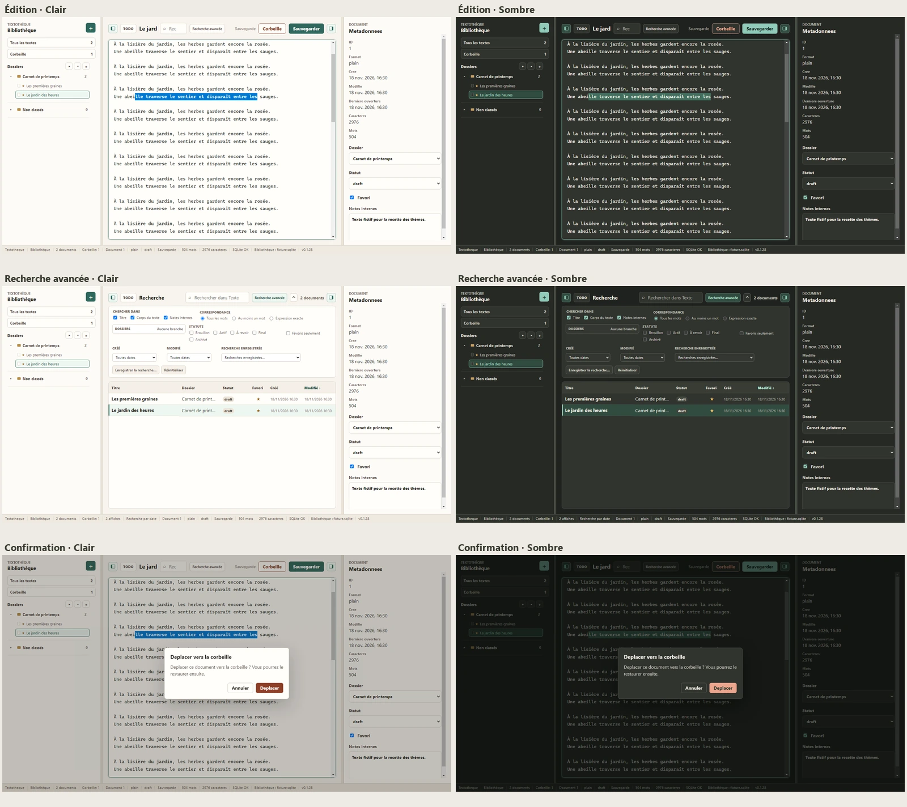

# Mission 048 — Menu Affichage et premier thème sombre

**Verdict technique — GO pour la recette humaine.** Contrôles réalisés le 18 novembre 2026 sur CODEX_VM, avec Textothèque 0.1.28. Le menu **Affichage → Thème → Clair / Sombre** agit sur la fenêtre ouverte. La préférence survit à la fermeture et s’applique aussi aux autres bibliothèques du même profil.

## Principe et démarrage

Dans `src/styles/app.css`, la palette claire de référence vit sur `:root`. Les règles communes emploient des variables par usage. Par exemple, `--pane`, `--surface` et `--field` distinguent les volets, la feuille d’écriture et les champs. Les rôles `--text-muted`, `--selected`, `--danger`, `--favorite` et `--focus-halo` permettent de régler séparément la lisibilité des états. Quelques nuances claires très proches ont été regroupées. Le sélecteur sombre ne redéfinit que la palette et le `color-scheme` des contrôles Chromium. Les deux palettes partagent la grille des barres d’outils, la typographie et les dimensions.

Le processus principal insère Affichage entre Bibliothèque et Recherche. Un choix radio transmet une intention via le preload. Le renderer applique le thème à la racine du document, enregistre `light` ou `dark` sous `textotheque:theme:v1` et communique le thème actif au processus principal. Celui-ci aligne les radios et le thème natif Electron. La clé est globale au profil, conformément à la séparation DEV et STABLE. La lecture d’une clé absente ou invalide donne le clair.

Le renderer lit la préférence avant le montage de React. La fenêtre est créée masquée puis affichée après le chargement. Sur les trois lancements contrôlés, le thème attendu était déjà appliqué au premier événement d’affichage. Ce contrôle porte sur l’état de la fenêtre, pas sur une mesure image par image du compositeur Windows.

## Comparaison dans Electron

Les six vues ci-dessous proviennent d’une même fenêtre Electron de 1 600 × 900, d’une même bibliothèque fictive et des mêmes commandes. Chaque paire montre le même état. Le test compare également les rectangles des volets, commandes de barre, éditeur, critères, tableau, barre d’état et dialogue lorsqu’ils sont présents.

| Surface | Observation |
| --- | --- |
| Navigation et volets | Le dossier, le favori et le document sélectionné se distinguent dans l’arbre ouvert. La poignée de séparation change de couleur au survol. |
| Éditeur, titre et métadonnées | La surface d’écriture se détache des volets. Le texte sélectionné reste lisible sur fond vert en sombre. La sélection arrière, le focus et le défilement survivent à l’aller-retour entre thèmes. |
| Barres normale et recherche avancée | Les commandes et le bouton des métadonnées gardent leurs ancrages. Les champs et les cases des critères restent identifiables. |
| Catalogue et barre d’état | Le fond d’en-tête distingue les colonnes. L’en-tête conserve sa position sticky. La ligne active se distingue des autres et Tab place un focus visible sur la commande de tri suivante. |
| TODO et corbeille | Le bouton TODO actif et la vue Corbeille ont été ouverts et inspectés. Les contrôles désactivés de la corbeille restent distincts des actions disponibles. |
| Confirmation | Le dialogue garde sa position. Le fond atténué, l’action secondaire et la commande de déplacement en corbeille sont distincts dans les deux thèmes. |

## Contrôles exécutés

| Commande | Résultat |
| --- | --- |
| `npm.cmd run build` | Compilation TypeScript et build Vite réussis. |
| `node scripts/electron-theme-check.cjs --captures` | Trois processus Electron successifs sur un profil temporaire. Clair initial, bascules immédiates et radios exclusifs, sombre après relance, retour au clair après préférence invalide. Le changement de bibliothèque conserve le sombre. Géométrie identique entre palettes. Après la bascule dans l’éditeur, aucun marqueur de modification et mêmes contenus et dates de modification pour les documents actifs. |
| `node scripts/electron-theme-check.cjs` | Nouveau passage réussi, avec vérification du thème à la première présentation de la fenêtre pour les trois lancements. |
| `node scripts/electron-search-navigation-check.cjs` | Navigation et commandes de recherche validées. |
| `node scripts/electron-editor-position-check.cjs` | Mémoire d’édition 047 validée, y compris après relance, sur texte raccourci et avec préférence corrompue. |
| `npm.cmd run test:preload` | Réussi avec un profil Chromium temporaire explicite. Le rejet IPC simulé est attendu et le contrôle se termine par `preload api ok`. |

Les bases, le registre et le profil de la recette sont temporaires. L’option `--captures` écrit les PNG dans `dist-electron/captures-048/`. La planche publiée contient uniquement des documents fictifs.

## Limites de la recette

Les commandes radio ont été actionnées via le véritable menu Electron. L’apparence du menu Windows ouvert et le confort d’écriture prolongée restent à apprécier lors de la recette humaine. Les suites complètes d’autosave, de migrations SQLite et de packaging n’ont pas été exécutées. Le contrôle documentaire de cette mission porte sur la bascule du thème. Aucun installateur n’a été fabriqué.
