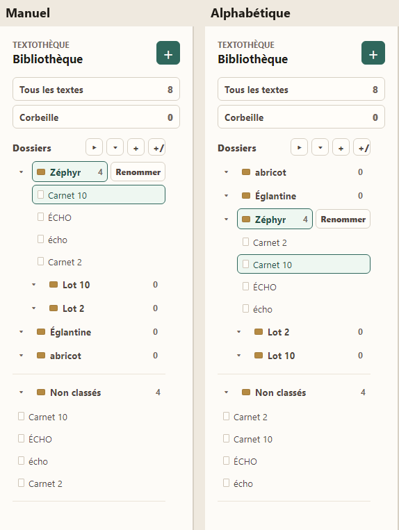

# Rapport 049 — Ordre de l’explorateur manuel ou alphabétique

**Verdict technique — GO pour la recette humaine**, le 22 novembre 2026 sur CODEX_VM avec Textothèque 0.1.28.

## Objectif et fonctionnement

**Affichage → Ordre de l’explorateur → Manuel / Alphabétique** agit immédiatement sur la section Dossiers du volet gauche. Les boutons Tous les textes et Corbeille gardent leur place. La branche Non classés reste après les dossiers racine.

**Manuel** reproduit l’ordre reçu par le volet. Pour les dossiers frères, la requête existante classe par position, puis par nom avec `COLLATE NOCASE`, puis par identifiant. Pour les documents, le volet conserve l’ordre du tableau fourni par l’application. Au chargement, `listDocuments()` le fournit par `updated_at DESC, id DESC`. Une bascule de préférence ne recharge pas ce tableau.

**Alphabétique** compare les noms des dossiers qui ont le même parent et les titres affichés des documents qui ont le même dossier, y compris Non classés. Le comparateur français `Intl.Collator('fr', { sensitivity: 'base', numeric: true })` place par exemple « Lot 2 » avant « Lot 10 ». En cas d’égalité de comparaison, le tri stable conserve l’ordre reçu. Le rendu continue de suivre les parents et l’état déplié de chaque dossier.

## Choix techniques et fichiers modifiés

- `src/services/explorer-order.ts` et `src/App.tsx` portent la préférence au niveau de la fenêtre, même lorsque le volet est masqué. Le renderer lit la clé de profil `textotheque:explorer-order:v1` au montage. Il accepte `manual` et `alphabetical`, avec repli sur Manuel si la clé est absente ou invalide.
- `electron/main.ts`, `electron/preload.cts` et `src/types/electron.d.ts` relient les deux radios natives au renderer. Le main reçoit l’ordre actif et le réutilise quand il reconstruit le menu, notamment après une ouverture de bibliothèque.
- `src/components/NavigationPane.tsx` trie des listes locales à l’arbre. Les compteurs, la sélection par identifiant, les chemins, l’ouverture automatique et les données utilisées par les autres vues conservent leurs sources existantes.
- `AGENTS.md` documente la clé. `scripts/electron-explorer-order-check.cjs` vérifie la mission. Le lanceur des trois sessions temporaires, extrait du test de thème, est partagé par les deux contrôles dans `scripts/preference-test-sessions.cjs`.

## Vérifications et commandes

| Commande | Résultat sur CODEX_VM |
| --- | --- |
| `npm.cmd run build` | Compilation TypeScript et build Vite réussis. |
| `node scripts/electron-explorer-order-check.cjs --captures` | Trois sessions Electron réussies. Manuel par défaut, radios exclusifs, tri immédiat des racines, sous-dossiers et documents, y compris Non classés. Les noms équivalents gardent leur ordre. Le document actif reste sélectionné et les branches repliées le restent pendant la bascule. |
| Même contrôle, sur la bibliothèque fictive | Retour exact à l’ordre initial. Même résultat de `SELECT id, parent_id, position FROM folders ORDER BY id` et même `PRAGMA data_version` sur une connexion témoin en lecture seule avant et après les bascules. Aucun marqueur de modification dans l’éditeur. |
| Même contrôle, en sombre puis après relance | Le renommage d’un document et celui de son dossier les repositionnent dans leur branche. La session suivante retrouve Alphabétique. Une seconde bibliothèque initialement rangée « Zulu, Alpha » s’affiche « Alpha, Zulu ». Après injection d’une préférence invalide et nouvelle relance, elle revient à « Zulu, Alpha », Manuel coché. |
| `node scripts/electron-theme-check.cjs` | Trois sessions réussies pour le thème, y compris la relance, le repli sur Clair et l’ouverture du TODO. |
| `node scripts/electron-search-navigation-check.cjs` | Navigation de recherche réussie, y compris le retour à l’origine. |
| `node scripts/electron-editor-position-check.cjs` | Position d’édition validée à la relance, après raccourcissement et avec une préférence corrompue. |

La recette utilise des dossiers et des textes créés pour le test. Le profil, le registre et les deux bibliothèques sont temporaires. La capture compare deux états de la même fenêtre. Pendant la mise au point, le contrôle de repli attendait à tort la première bibliothèque après relance. Il vérifie désormais la seconde, rouverte par le registre. Un problème d’encodage du libellé « Thème » dans le test voisin a également été corrigé avant son passage réussi.

## Versionnement, limites et validation

La version applicative reste 0.1.28 et le schéma SQLite reste en version 5. Le périmètre porte sur la préférence d’affichage. Les suites de migration, de packaging et la suite UI générale n’ont pas été rejouées. La création des dossiers et des documents utilise les API existantes dans les fixtures. Les renommages passent par les contrôles réels du renderer. Le test actionne les radios du menu natif Electron par leur commande. L’appréciation du menu ouvert et de la lisibilité de l’arbre revient à la recette humaine.
