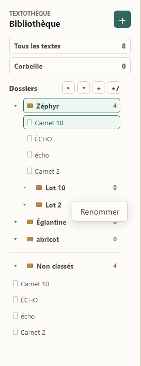
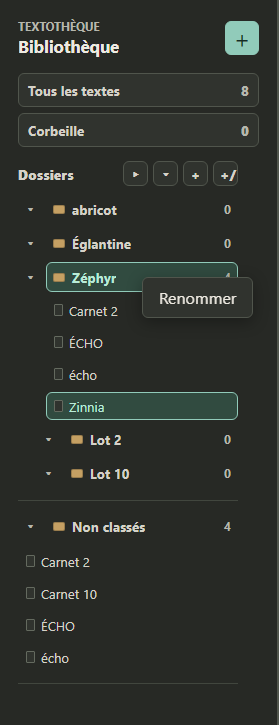

# Rapport 050 — Renommer un dossier par clic droit

**GO pour la recette humaine.** Sur CODEX_VM, le double clic sur le nom et la commande **Renommer** du clic droit ouvrent le même champ dans la ligne du dossier. Entrée et la perte de focus valident la saisie. Échap l’annule. Le simple clic droit laisse le document actif, la sélection et les branches dans leur état courant.

## Interface et choix techniques

Dans `src/components/NavigationPane.tsx`, le nom et le chevron des dossiers réels ouvrent un petit menu du renderer. Le menu utilise les couleurs du thème actif et reçoit le focus à l’ouverture. Il se ferme sur choix, Échap ou clic ailleurs. Échap rend le focus à la cible. Le choix du renderer permet de réutiliser directement `startRename`, déjà appelé par le double clic, sans nouvel échange IPC.

Dans `src/styles/app.css`, la ligne comporte deux colonnes, pour le chevron puis pour le nom avec son compteur. Le bouton permanent de la ligne sélectionnée et sa troisième colonne ont été retirés ensemble. Les mesures dans Electron confirment que le bord droit du bouton portant le nom coïncide avec celui de la ligne, dossier sélectionné compris.

Dans `src/App.tsx`, un renommage réussi rafraîchit uniquement la liste des dossiers. L’ancien rafraîchissement réappliquait aussi à l’éditeur le contenu du document lu en base. Ce détail importait dès qu’on pouvait renommer un autre dossier tout en gardant son brouillon ouvert.

## Recette dans Electron sous Windows

Les captures montrent le volet d’une bibliothèque temporaire fictive. À gauche, le clic droit vise Églantine alors que Zéphyr et son document Carnet 10 restent sélectionnés.

| Manuel · clair | Alphabétique · sombre |
| --- | --- |
|  |  |

- **Manuel.** Le clic droit ouvre uniquement le menu. Un clic sur Renommer puis Entrée valide « Églantine » → « Branche » au même rang. Le double clic ouvre aussi le champ. Échap abandonne le nom saisi, puis une nouvelle édition validée par perte de focus rétablit « Églantine ».
- **Alphabétique.** En sombre, Entrée sur la commande focalisée ouvre le champ. « Zéphyr » renommé « Brume » se replace entre « abricot » et « Églantine », avec ses deux sous-dossiers. Les identifiants, parents et positions SQLite des dossiers sont identiques avant et après ces essais.
- **Document courant.** Ouvrir et fermer le menu conserve la sélection et le repli des dossiers, sans apparition du marqueur de modification. Avec un brouillon en cours, renommer un autre dossier conserve le texte dans l’éditeur. Une sauvegarde explicite puis une relecture confirment son contenu.

## Commandes et résultats

| Commande | Résultat |
| --- | --- |
| `npm.cmd run build` | TypeScript et Vite réussis. |
| `node scripts/electron-explorer-order-check.cjs --captures` | Trois sessions réussies. Le contrôle 049 étendu à 050 envoie les événements de souris et de clavier à la vraie fenêtre Electron. Il couvre aussi la persistance du tri, sa valeur de repli et le changement de bibliothèque. |
| `node scripts/electron-theme-check.cjs` | Trois sessions réussies, dont la relance en sombre et le repli en clair. |

## Versionnement et limites

Version applicative 0.1.28, schéma SQLite 5. La suite UI générale utilise désormais le double clic aux deux endroits qui cherchaient l’ancien bouton. Elle n’a pas été rejouée intégralement. Les suites de migration et le packaging sont hors de cette recette. Les vérifications ont utilisé les profils et bibliothèques temporaires des tests. Le confort du geste et le placement du menu sur le poste du mainteneur restent à apprécier en recette humaine.
