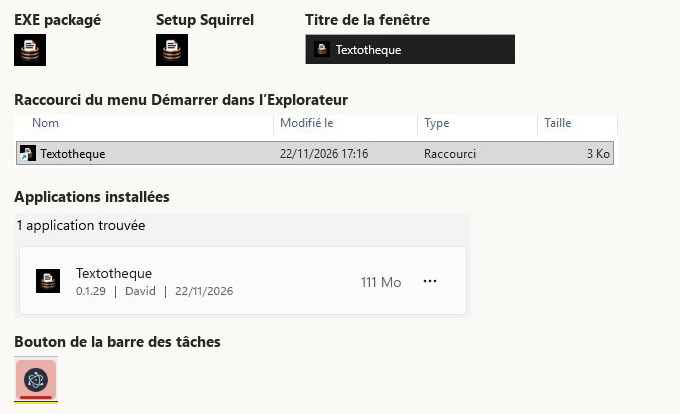

# Rapport 053 — Identité visuelle et intégration de l’icône

**Verdict PARTIEL sur CODEX_VM.** La candidate 0.1.29 affiche le dessin validé sur l’EXE, le Setup, la fenêtre, le raccourci Démarrer et la fiche Applications installées. Le bouton de la barre des tâches a continué d’afficher l’atome Electron dans la session Windows testée. L’identité Squirrel, le chemin de lancement et le profil fictif de 052 ont passé leurs contrôles.

## Sources et configuration

Git a enregistré les deux déplacements avec une similitude de 100 %. Les empreintes ont été comparées de part et d’autre du déplacement.

| Source canonique | Format | SHA-256 |
| --- | --- | --- |
| `assets/branding/textotheque-icon.png` | Référence 1 254 × 1 254 px | `e50b45f0d97745354a7a50621cf11bba154a44f5a48bc47f90456aa877ae850c` |
| `assets/branding/textotheque.ico` | 10 tailles de 16 à 256 px | `acfa945ef7ff56f8e29a74f0ca1d8374ba5533a9dc07c6967f1e33e70005f201` |

Dans `forge.config.cjs`, `packagerConfig.icon` utilise l’ICO pour l’EXE et `setupIcon` pour le Setup Squirrel. `iconUrl` pointe vers le même fichier à la révision immuable `65c87cfe` pour l’inscription Windows. Sur la VM, le fichier installé désigné par `DisplayIcon` a exactement le SHA-256 de l’ICO de David.

`extraResource` distribue uniquement une copie de l’ICO dans `resources/textotheque.ico`. La fenêtre DEV le lit depuis le dépôt et la fenêtre STABLE depuis `process.resourcesPath`. Ce chemin explicite permet à DEV d’utiliser le visuel malgré son lancement par le binaire Electron de développement. Le renderer conserve son chargement local. L’inspection de l’ASAR a confirmé l’exclusion du PNG de référence, des missions, des captures de recette et des bibliothèques SQLite.

## Vérifications Windows

| Surface | Observation |
| --- | --- |
| EXE packagé, lanceur Squirrel et EXE installé versionné | Le premier groupe d’icônes de chaque PE contient les dix images du fichier validé, identiques octet par octet. |
| Setup | Même résultat pour les dix ressources. Windows extrait bien l’icône document/base du Setup local. |
| Raccourci menu Démarrer | Une seule entrée, `Programs\David\Textotheque.lnk`. Sa cible et sa source d’icône sont `%LOCALAPPDATA%\Textotheque\Textotheque.exe`, index 0. L’Explorateur affiche le visuel sur le raccourci. |
| Fenêtre | La relance par ce raccourci ouvre `app-0.1.29\Textotheque.exe`. Le titre affiche la petite icône document/base. |
| Applications installées | La recherche « Textotheque » donne une application, version 0.1.29, éditeur David, avec l’icône validée. Le registre désigne `%LOCALAPPDATA%\Textotheque\app.ico`. |
| Barre des tâches | Le bouton Windows identifié « Textotheque - 1 fenêtre en cours d’exécution » affiche encore Electron. Vérification répétée après notification de changement des fichiers au shell, actualisation d’affichage, fermeture et relance. La candidate finale fournit aussi explicitement l’icône de relance via `BrowserWindow.setAppDetails`, sous le même AppUserModelID. Le résultat visuel persiste. |

La planche rassemble les icônes associées aux binaires par Windows et des extraits de captures des surfaces correspondantes. Le raccourci et la fiche Paramètres ont été capturés lors du premier passage. Le titre et le bouton de barre des tâches ont été recapturés avec la candidate finale. Les sources graphiques de David n’ont subi aucune transformation.

## Installation et profil

Le Setup historique qualifié en 052 a été conservé localement avant la nouvelle fabrication. Les Setup de 053 ont été exécutés directement sur la 0.1.29 fictive fermée, après contrôle du marqueur 052 et comparaison des données avec le relevé historique. L’ASAR installé correspondait au package produit. Une entrée Démarrer et une entrée de désinstallation sont présentes. Windows expose toujours `com.squirrel.Textotheque.Textotheque`. Le package Squirrel reste `Textotheque`, son exécutable `Textotheque.exe` et son installateur `Textotheque Setup.exe`.

La comparaison finale des relevés retrouve la même racine d’installation, le dossier du profil `%APPDATA%\Textotheque` avec sa date de création initiale, les deux bibliothèques connues et les sentinelles métier. La base principale fermée a conservé 114 688 octets et le SHA-256 `1c188119a2ae8c908c838ad8fb5c0a38bf20704545303ecdde682f245d838c53` entre le début et la fin de 053. La fenêtre fictive a été fermée normalement.

## Construction, tests et limites

- `npm.cmd run release:win` — build TypeScript/Vite, packaging, fabrication Squirrel et manifeste réussis. Candidate finale construite sur `5fbfa390457639991dcb8f34302b7a754220a11a`, arbre propre, 0.1.29, Setup de 117 038 592 octets. SHA-256 **`4ea8450bff132feacec8b8beb0aa2b9f0d743f7f7a5e67b6a19baca4064e65ee`**.
- `npm.cmd run test:packaged-smoke`, `test:installer-smoke`, `test:app-identity` et `test:runtime-profile` — réussis sur la candidate finale. Version 0.1.29, runtime packagé en `file:`, schéma 5 et isolation du profil DEV confirmés.
- `python scripts/check-windows-icon.py <EXE> ...` — comparaison en lecture seule des ressources PE du Setup, du package, du lanceur et de l’EXE installé avec l’ICO source. Quatre contrôles réussis. `node scripts/electron-theme-check.cjs` a aussi ouvert la fenêtre DEV sur trois sessions temporaires fictives.
- Le contrôle 052 sur copies avant/après a réussi. Le cycle intégral 0.1.28 → 0.1.29 n’a pas été rejoué en 053. Les paramètres d’identité et de chemin qualifiés en 052 sont conservés. Les suites métier générales n’ont pas été relancées.
- La cause de l’icône de barre des tâches reste indéterminée. La revue automatique d’autorisation a refusé un essai complémentaire de désinstallation/réinstallation, en raison de son caractère destructif. Cette opération n’a pas été exécutée. Aucun cache système n’a été supprimé. Le Setup et les paquets restent sur CODEX_VM. Aucun transfert vers Zenith Ice.
