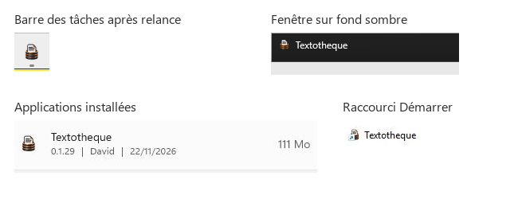

# 053a — Icône transparente et diagnostic de la barre des tâches

**GO sur CODEX_VM, le 22 novembre 2026.** Après redémarrage du shell Windows, le bouton de barre des tâches affiche l’icône cuivre et la conserve à la relance suivante de Textothèque. La fenêtre, le raccourci recréé et Applications installées affichent également le visuel transparent.

## Source et fabrication

L’ICO de David a remplacé à l’identique `assets/branding/textotheque.ico`. Son SHA-256 est `8c09033181f9d5af931eaeea24aceebe2614c0cfa5b56b0490b4121f8b52ca85`. Le décodage des dix images de 16, 20, 24, 32, 40, 48, 64, 96, 128 et 256 px donne pour chacune un alpha minimum de 0, un maximum de 255 et un coin supérieur gauche transparent. Le PNG de référence reste celui de 053. Forge référence le nouvel ICO par une URL immuable pour l’inscription Squirrel.

Le build x64 et la commande complète `npm.cmd run release:win` ont produit le package Electron, `Textotheque Setup.exe`, `Textotheque-0.1.29-full.nupkg` et `RELEASES` depuis le commit propre `9ef64031bcbb485c932ae6b48c33a4ea46c5d054`. Le Setup compte 117 161 472 octets, SHA-256 `c88b918efb47c12d71076e022377c5096556399fcfca7925f00505bd52767363`.

Le script de 053, `scripts/check-windows-icon.py`, a retrouvé les dix images identiques octet pour octet dans le Setup, l’EXE packagé, le lanceur Squirrel et l’EXE installé versionné. Windows extrait le symbole cuivre du Setup. Les fichiers installés `app.ico` et `app-0.1.29/resources/textotheque.ico` ont aussi le SHA-256 exact de David.

## Diagnostic Windows

| Étape | Observation |
| --- | --- |
| Réinstallation propre et lancement par le raccourci recréé | Le titre sombre affiche le cuivre. Le bouton Windows identifié « Textotheque - 1 fenêtre en cours d’exécution » affiche encore l’atome Electron. |
| Vérification des sources | La grande icône Win32 de la fenêtre et celle de sa classe montrent déjà le cuivre. Le raccourci Démarrer désigne le lanceur installé, index 0, avec le bon AppUserModelID. Aucun raccourci Electron ou Textothèque correspondant dans les répertoires utilisateur de raccourcis épinglés ou implicites inspectés. |
| Fermeture normale, redémarrage du seul processus Explorer propriétaire du shell, relance par le même raccourci | Le même bouton affiche le cuivre sur fond clair. Une nouvelle fermeture et relance confirme ce résultat avec le même binaire. |
| Explorateur et Applications installées | Une vue du dossier déjà ouverte gardait un carré noir autour du raccourci. Après actualisation et ouverture d’une nouvelle vue du dossier Démarrer, le raccourci apparaît transparent. Paramètres affiche une seule application Textotheque 0.1.29, éditeur David, avec le cuivre sans carré noir. |

Ces observations isolent un état d’affichage conservé par le shell dans cette session. Le fichier ou composant précis du cache reste indéterminé. Aucune purge, déconnexion ou modification de l’AppUserModelID n’a été nécessaire.

## Qualification sur le profil fictif

Avant désinstallation, vérification du nom de machine `CODEX-VM`, de l’absence de processus Textotheque, du marqueur `qualification-052.txt`, de l’entrée Squirrel 0.1.29 et du registre limité aux deux bibliothèques fictives connues. Leurs empreintes correspondent à 052–053. Le comparateur historique a validé le relevé. Une copie locale du profil fermé a été conservée hors Git.

La commande déclarée par Squirrel, `Update.exe --uninstall -s`, a terminé avec le code 0. Avant réinstallation, le lanceur, le raccourci et l’entrée de désinstallation avaient disparu. Le profil Roaming existait toujours avec les deux SQLite intactes. Le Setup a recréé le programme et le raccourci. Aucune restauration de profil n’a été nécessaire.

Le relevé final retrouve une seule installation, un seul raccourci Démarrer, le même lanceur sous `%LOCALAPPDATA%\Textotheque`, le profil `%APPDATA%\Textotheque` avec sa date de création initiale et l’AppUserModelID `com.squirrel.Textotheque.Textotheque`. Les seuls profils Textothèque recensés sont STABLE et DEV. Les SHA-256 des deux bases sont identiques avant désinstallation, juste après désinstallation et en fin de recette. La comparaison avec 052 valide aussi les dossiers, documents, TODO, corbeille, recherche enregistrée et registre. La STABLE fictive a été fermée normalement.

## Tests et limites

Build, release Windows, `test:packaged-smoke`, `test:installer-smoke`, `test:app-identity`, `test:runtime-profile`, contrôle des quatre exécutables et comparaison de la fixture 052 réussis. Les smokes utilisent des profils temporaires. Le renderer installé charge ses fichiers locaux et le schéma reste en version 5.

Les suites métier générales et le cycle intégral 0.1.28 → 0.1.29 n’ont pas été rejoués. Le code Electron, le mécanisme de mise à jour, la version, les identités et les chemins restent ceux qualifiés en 052–053. Les artefacts et la fixture restent sur CODEX_VM. Aucun transfert vers Zenith Ice.
